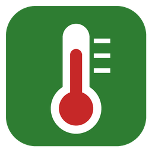

<p align="center">
  
</p>

<h1 align="center">CPU Temp Tray</h1>

<p align="center">
  Маленькая программа для Windows 10/11, которая показывает температуру процессора прямо в трее.
</p>

---

<!-- Добавьте скриншот: сохраните его как docs/screenshot.png и раскомментируйте строку ниже -->
<!--  -->

## Возможности

- Число в трее с текущей температурой CPU, обновляется каждые 2 секунды
- Цвет иконки: 🟢 до 60 °C, 🟠 60–79 °C, 🔴 от 80 °C
- Всплывающая подсказка с текущей и максимальной температурой за сеанс
- Окно «Подробно» с температурой по каждому ядру
- Автозапуск при входе в Windows (через Планировщик заданий)
- Один `.exe`, установка .NET не нужна
- Работает с процессорами Intel и AMD

## Установка

1. Скачайте `CpuTempTray.exe` со страницы [Releases](../../releases).
2. Установите драйвер **PawnIO**, через который читаются датчики. В терминале от имени администратора:
   ```
   winget install namazso.PawnIO
   ```
   Драйвер ставится один раз. Если у вас уже установлены LibreHardwareMonitor или FanControl, он, скорее всего, уже есть.
3. Запустите `CpuTempTray.exe` и подтвердите запрос прав администратора.

> **Совет.** Windows 11 прячет новые значки в скрытую область. Чтобы температура была видна всегда, перетащите значок из меню «^» на панель задач.

## Использование

| Действие | Результат |
|---|---|
| Навести курсор на иконку | Текущая и максимальная температура |
| Двойной щелчок / «Подробно…» | Температура по всем датчикам |
| «Запускать при входе в Windows» | Включить или выключить автозапуск |
| «Выход» | Закрыть программу |

## Сборка из исходников

Нужен [.NET 8 SDK](https://dotnet.microsoft.com/download/dotnet/8.0).

```
git clone https://github.com/<ваш-логин>/CpuTempTray.git
cd CpuTempTray
build.bat
```

или вручную:

```
dotnet publish src/CpuTempTray/CpuTempTray.csproj -c Release -r win-x64 --self-contained true -p:PublishSingleFile=true -o publish
```

Готовый файл появится в `publish/CpuTempTray.exe`.

### Автоматические релизы

GitHub Actions собирает программу при каждом push в `main`. Если отправить тег вида `v1.0.0`, сборка автоматически публикуется как релиз:

```
git tag v1.0.0
git push origin v1.0.0
```

## Частые вопросы

**Почему нужны права администратора?**
Датчики температуры доступны только через драйвер ядра, а загрузить его может только администратор.

**В трее «--» и написано «датчик не найден».**
Не установлен драйвер PawnIO. Смотрите шаг 2 в разделе «Установка».

**Почему автозапуск через Планировщик, а не через автозагрузку?**
Программы, которым нужны права администратора, Windows из обычной автозагрузки не запускает. Задание в Планировщике запускает программу с нужными правами и без запроса UAC.

**Как удалить?**
Снимите галочку автозапуска, закройте программу и удалите `.exe`.

## Структура проекта

```
src/CpuTempTray/
├── Program.cs           — точка входа, защита от повторного запуска
├── TrayApp.cs           — иконка в трее, меню, таймер
├── CpuSensor.cs         — чтение датчиков через LibreHardwareMonitor
├── TrayIconRenderer.cs  — отрисовка иконки с числом
├── Autostart.cs         — автозапуск через Планировщик заданий
└── app.manifest         — запрос прав администратора, DPI
```

## Благодарности

- [LibreHardwareMonitor](https://github.com/LibreHardwareMonitor/LibreHardwareMonitor) — библиотека для чтения датчиков (MPL-2.0)
- [PawnIO](https://pawnio.eu/) — драйвер доступа к оборудованию

## Лицензия

[MIT](LICENSE). Библиотека LibreHardwareMonitorLib распространяется по лицензии MPL-2.0, её исходный код доступен по ссылке выше.
